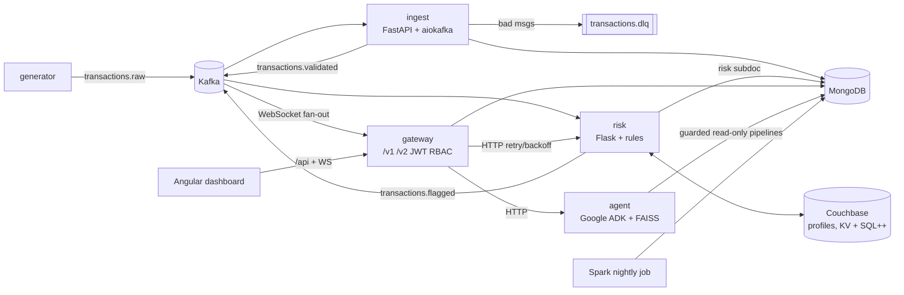

# LedgerLens

A real-time transaction intelligence platform for a banking context, built as a portfolio project.
Synthetic transactions stream through Kafka. They are validated into MongoDB, scored by explainable
risk rules backed by Couchbase, and served through a versioned API gateway to an Angular dashboard.
Analysts can query the data in natural language through a Google ADK agent that only produces
allow-listed, read-only pipelines.

> **Synthetic data only.** Everything is generated with Faker. There are no real names, card numbers or PII.

## Architecture



There are more diagrams in [docs/architecture.md](docs/architecture.md): end-to-end sequences, the
data model, topics and delivery guarantees.

## Quickstart

```bash
cp .env.example .env              # then set JWT_SECRET, passwords (openssl rand -hex 32)
make up                           # core: Kafka, Mongo, Couchbase, generator, ingest, risk, gateway
PROFILES="core ui" make up        # + dashboard at http://localhost:4200
make semantic-index && PROFILES="core ai" make up   # + query agent
make test && make lint            # pytest (testcontainers), ruff, mypy --strict
```

| Profile | Adds | Notes |
|---|---|---|
| `core` | Kafka, Mongo, Couchbase, generator, ingest, risk, gateway | Couchbase alone takes about 1–1.5 GB |
| `ui` | Angular + nginx | needs `core` |
| `ai` | agent (torch, MiniLM, FAISS) | needs `core`; about 1 GB more |
| `spark` | nightly aggregates job (run once) | 2 GB memory limit |

**Hardware:** this was developed on Apple Silicon (10 CPU, 16 GB) with Docker Desktop at 8 GB. The full
stack needs substantial RAM, so use `core` alone on smaller machines. For `make deploy-local` (kind),
stop the compose stack first. The Helm requests and limits come to an estimated 4–5 GB.

## How each concept is implemented

| Concept | Where | How |
|---|---|---|
| Async I/O | [services/ingest](services/ingest/src/ingest/pipeline.py) | aiokafka with manual commit **after** the idempotent Mongo write (`_id = txn_id`) and the downstream acks: at-least-once, without duplicates. Graceful shutdown happens in the FastAPI lifespan. |
| Validation and DLQ | `ingest.pipeline.parse` | Pydantic v2 with `extra="forbid"`, money as `Decimal` stored as `Decimal128`, aware datetimes. Rejects go to `transactions.dlq` with a reason. |
| Indexing | `INDEXES` in the ingest pipeline | compound `customer_id + timestamp desc` and `merchant + timestamp desc`. `make bench` runs explain() with and without them. |
| Explainable risk | [services/risk](services/risk/src/risk/rules.py) | pure rule functions (VELOCITY, AMOUNT_ZSCORE, COUNTRY_JUMP), each with a reason code. Couchbase KV with CAS for rolling profiles, plus one SQL++ top-risky report. Config is validated at startup (exit 78). |
| API versioning | [docs/api-versioning.md](docs/api-versioning.md) | v1 uses offset pages with a flat shape; v2 makes a deliberate breaking change to an opaque cursor over `(timestamp, _id)` with a nested `risk` object. v1 keeps working. |
| Resilience | `gateway/upstream.py` | timeouts, exponential backoff with jitter, retries on GET only, and one error schema `{code, message, request_id}`. |
| RBAC and audit | `gateway/auth.py`, `agent/service.py` | JWT HS256 with roles analyst and admin; `/v2/audit` is admin-only. Every agent query is written to `audit_log`, including rejected ones and planner failures. |
| Semantic layer | [semantic/catalog.yaml](semantic/catalog.yaml) | 20 business terms (owner, sensitivity, filter/pipeline), embedded with MiniLM into a FAISS index. |
| LLM controls | [agent/guard.py](services/agent/src/agent/guard.py), [agent/pii.py](services/agent/src/agent/pii.py) | recursive stage allowlist that rejects `$out`, `$merge`, `$function`, `$where` and `$accumulator` at any depth, collection RBAC, a forced `$limit`, `maxTimeMS`, and PII masking by key and by value. |
| Kubernetes | [deploy/helm](deploy/helm) | one chart per service plus an umbrella: Deployments, Services, ConfigMaps, Secrets, probes, resource limits, HPAs (ingest and gateway), a CronJob (Spark), and non-root containers with a read-only root filesystem. |
| OpenShift and Harness | [deploy/openshift](deploy/openshift), [deploy/harness](deploy/harness) | arbitrary-UID-safe images (GID 0), Routes, and a Helm-based pipeline. |
| Observability | `ledgerlens_common/logging.py` | JSON logs. `request_id` propagates via the `X-Request-ID` header over HTTP and via the `x-request-id` header on Kafka messages. |

## Benchmarks (measured, single laptop)

Each benchmark below ran once, with the raw output saved under [benchmarks/results/](benchmarks/results/).
Kafka and Mongo were single nodes, and the load generator ran on the same machine as the system
under test, so treat these as relative numbers rather than capacity claims.

| What | Command | Result |
|---|---|---|
| Mongo indexes (200k docs) | `make bench` | customer_recent: COLLSCAN examining 200,000 docs at 41 ms p50 → IXSCAN examining 50 docs at 0.49 ms |
| Ingest drain, 50k backlog into Mongo + validated topic | `make bench-ingest` | 32,145 msg/s; end-to-end p50 1.4 ms / p95 2.8 ms at 500 msg/s |
| Gateway pagination at about 10k rows deep (c=16) | `make bench-gateway` | v1 offset p50 63.4 ms, 252 req/s; v2 cursor p50 20.9 ms, 550 req/s |
| Risk scoring with Couchbase KV + CAS, serial | `make bench-risk` | 2,167 txn/s (rules alone, in-process: 94,164 txn/s) |

## Agent eval

`make eval` runs 35 questions, including RBAC and prompt-injection controls. Each expected answer is
computed independently in Python from deterministically seeded data.

| Planner | Result |
|---|---|
| Deterministic catalog planner (no LLM) | **33/35 (0.943)**. Both failures are retrieval misses ([details](benchmarks/results/agent_eval_catalog.md)). |
| LLM planner (ADK; Gemini, Claude or `openai/*` via LiteLLM) | not measured yet. Run `PLANNER=adk AGENT_MODEL=openai/gpt-4o-mini make eval` with a key in `.env`. |

## Docs

[Architecture](docs/architecture.md) · [Runbook](docs/runbook.md) · [API versioning](docs/api-versioning.md) ·
[Cloud demo (Render + Vercel)](docs/cloud-deploy.md) · [Deploy / Helm](deploy/README.md)

## Known limitations

- **Unfinished deliverables:** the kind deploy hasn't been verified end to end with all pods Ready and the
  smoke test passing. The incident exercise (`docs/postmortem.md`) hasn't been done yet.
- **Risk rules:** precision is 0.41 and recall 0.56 against synthetic labels ([risk_eval](benchmarks/results/risk_eval.md)).
  That was measured on data from mixed generator runs, before the stable-customer fix. The z-score also
  ignores currency conversion.
- **Duplicates:** at-least-once delivery means a retried batch can re-publish to `transactions.flagged`.
- **Driver:** motor is in maintenance mode, and PyMongo's async client is its successor.
- **Dev setup:** dev Kafka is a single broker, and the WebSocket JWT is checked only at connect.
- **Cloud configs:** the Render and Vercel configs haven't been deployed to a live account.
