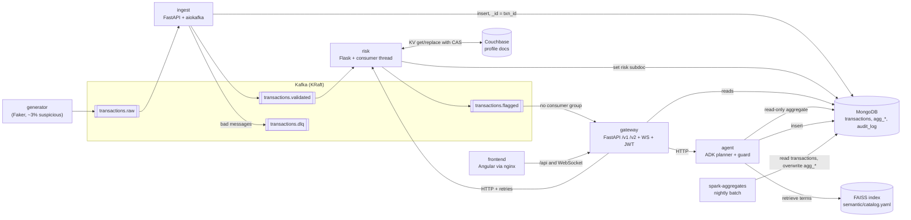
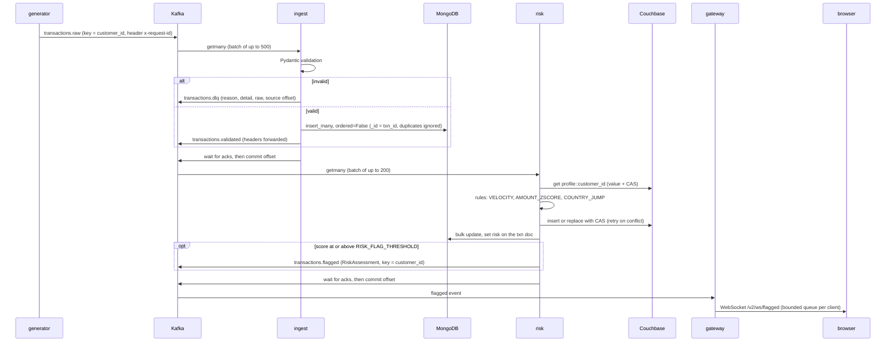

# LedgerLens architecture

LedgerLens ingests a synthetic card-transaction stream, validates and stores it, scores every
transaction for fraud risk with explainable rules, and serves the results to analysts through a
versioned API, a live dashboard and a natural-language query agent. All data is synthetic (Faker).

Performance numbers are not quoted here. Every measured number lives in
[`benchmarks/results/`](../benchmarks/results/) next to the command that produced it.

## Components



| Service | Code | Port | Role |
|---|---|---|---|
| generator | `services/generator` | none (worker) | Publishes synthetic transactions to `transactions.raw` at `GEN_RATE_PER_SEC` |
| ingest | `services/ingest` | 8000 | Validates, stores in Mongo, republishes to `transactions.validated`, dead-letters bad input |
| risk | `services/risk` | 8001 | Scores each validated txn (VELOCITY, AMOUNT_ZSCORE, COUNTRY_JUMP); profiles in Couchbase |
| gateway | `services/gateway` | 8002 | Public API: `/v1`, `/v2`, WebSocket, JWT RBAC; proxies risk and agent |
| agent | `services/agent` | 8003 | Question → catalog retrieval → pipeline → allowlist guard → Mongo → masked answer + audit |
| spark-aggregates | `jobs/spark_aggregates` | none (batch) | Nightly aggregates into `agg_*` collections |
| frontend | `frontend` | 8080 (container) | Angular dashboard; nginx serves it and proxies `/api/` to the gateway |
| shared library | `libs/common` | n/a | `Transaction` / `RiskAssessment` models, topic names, JSON logging |
| semantic layer | `semantic` | n/a | Business-term catalog, FAISS index build and `search()` |

## One transaction, end to end



## One agent query

```mermaid
sequenceDiagram
    participant B as browser
    participant W as gateway
    participant A as agent
    participant F as FAISS
    participant L as LLM planner
    participant M as MongoDB

    B->>W: POST /v2/agent/query {question} + Bearer JWT
    W->>W: verify JWT; user and role come from the token
    W->>A: POST /query {question, user, role}
    A->>F: search(question, k=4)
    F-->>A: catalog terms (definition, filter, pipeline)
    A->>L: plan (ADK LlmAgent, or the deterministic catalog planner)
    L-->>A: collection, pipeline, terms_used
    A->>A: guard.validate: collection allowed for role, stages read-only, add limit
    alt rejected
        A->>M: audit_log insert (allowed = false, reason)
    else allowed
        A->>M: aggregate with maxTimeMS
        A->>A: mask PII in rows
        A->>M: audit_log insert (allowed = true)
    end
    A-->>W: answer, terms_used, pipeline, rows, allowed
    W-->>B: same body
```

## Data model

### MongoDB, database `ledgerlens`

| Collection | Written by | Key fields | Indexes |
|---|---|---|---|
| `transactions` | ingest (insert), risk (`$set risk`) | `_id` = txn_id, `customer_id`, `merchant`, `category`, `amount` (Decimal128), `currency`, `country`, `channel`, `timestamp`, `ingested_at`, optional `synthetic_pattern`, `risk {score, flagged, reasons[{code, detail}], scored_at}` | `customer_ts` (customer_id 1, timestamp -1) and `merchant_ts` (merchant 1, timestamp -1), created by ingest; `flagged_ts` (risk.flagged 1, timestamp -1), created by risk; `ts_id` (timestamp -1, _id -1), created by gateway |
| `agg_daily_category_spend` | Spark | `day`, `category`, `currency`, `txn_count`, `total_amount`, `computed_at` | none (small, overwritten nightly) |
| `agg_merchant_flagged_rate` | Spark | `merchant`, `total_txns`, `flagged_txns`, `flagged_rate`, `computed_at` | none |
| `agg_top_customers` | Spark | `customer_id`, `txn_count`, `amounts[{currency, total_amount}]`, `rank`, `computed_at` | none |
| `audit_log` | agent | `user`, `role`, `question`, `pipeline`, `collection`, `terms_used`, `planner`, `allowed`, `reason`, `row_count`, `timestamp` | none yet |

Design notes:
- **`_id` = txn_id.** This is what makes ingest idempotent: a redelivered message hits a duplicate-key error (11000), which `insert_idempotent` ignores (`services/ingest/src/ingest/pipeline.py`).
- **Money is Decimal end to end.** `Transaction.amount` is a Pydantic `Decimal` (2 places), stored as BSON `Decimal128`, served by `/v2` as a string, and read by Spark as `DecimalType(18, 2)`. Amounts are never summed across currencies.
- **A missing `risk` means "not scored yet".** Readers treat it as not flagged: the gateway filter uses `{"$ne": true}`, and the Spark schema makes `risk` nullable.
- **`synthetic_pattern`** is the generator's ground-truth label, passed in a Kafka header rather than the payload. It is stored only so the risk rules can be evaluated; the API never exposes it.

### Couchbase, bucket `ledgerlens`

- **One KV document per customer**, keyed `profile::<customer_id>` (`services/risk/src/risk/rules.py`, `Profile`). It holds `type: "profile"`, `home_country`, `txn_count`, Welford running mean and M2 of log(amount), `last_country` / `last_ts`, the last 20 scored txns in `recent` (used for velocity and redelivery detection), `flagged_count`, `max_score` and `updated_at`.
- **Writes are read, compute, then `replace(cas=...)`, or `insert` for a new customer**, retried up to 10 times with jittered backoff on `CasMismatchException` / `DocumentExistsException` (`store.py`).
- **The SQL++ "top risky customers" report** is served by the partial GSI index `idx_profile_risk ON ledgerlens(flagged_count DESC, max_score DESC) WHERE type = 'profile'`, which the risk service creates at startup. The query runs with `REQUEST_PLUS` scan consistency. The bucket itself is created by `services/risk/couchbase-init.sh`.

## Kafka topics

All four topics are created up front (6 partitions each in compose; `auto.create.topics.enable=false`).

| Topic | Key | Payload | Producer | Consumer (group) | Commit semantics |
|---|---|---|---|---|---|
| `transactions.raw` | customer_id | `Transaction` JSON; headers `x-request-id`, optional `x-synthetic-pattern` | generator (`acks=all`, idempotent) | ingest (`ingest`) | manual, after the Mongo write and downstream acks |
| `transactions.validated` | customer_id | normalised `Transaction` JSON, headers forwarded | ingest | risk (`risk`) | manual, after Couchbase, Mongo and flagged acks |
| `transactions.dlq` | original key | `{reason, detail, raw, source{topic, partition, offset}, failed_at}` | ingest | none (inspected by hand; see runbook) | n/a |
| `transactions.flagged` | customer_id | `RiskAssessment` JSON (flagged only) | risk | gateway (`group_id=None`, `auto_offset_reset=latest`) | none: every gateway replica reads every partition, and the live feed doesn't replay history |

Keying by `customer_id` keeps each customer's transactions on one partition, and therefore in order. The risk rules depend on that, since velocity and country jump compare a transaction with the customer's previous one.

## Delivery guarantees and idempotency

The system is **at-least-once with idempotent side effects** at every stage. The pattern repeats:
do the side effects, wait for broker acks on anything published, and commit the offset last.
A crash before the commit means the batch is re-read.

| Stage | On redelivery | Why it's safe |
|---|---|---|
| generator → raw | producer retries can't duplicate | `enable_idempotence=True`, `acks="all"` |
| ingest → Mongo | duplicate insert ignored | `_id` = txn_id; error 11000 swallowed, other write errors re-raised |
| ingest → validated / dlq | **re-published** | downstream must dedupe on txn_id (risk does) |
| ingest failure | batch retried | `seek` back to the first offset, backoff 1s doubling to 30s, no commit |
| risk → Couchbase | profile not double-counted | `find_recent` returns the stored result if txn_id is among the customer's last 20 txns |
| risk → Mongo | same `$set` again | idempotent by construction |
| risk → flagged | **may be re-published** | at-least-once; WebSocket clients may see a duplicate |
| Spark → agg_* | full recompute, `mode("overwrite")` | re-running is safe |
| agent → audit_log | one insert per answered query | the gateway doesn't retry POSTs that may have reached the agent (connect failures only) |

## API versioning

`/v1` (offset pagination, flat risk fields, float amounts) is frozen. `/v2` (keyset cursor over
`(timestamp, _id)`, nested `risk` object or `null`, `money {amount: "12.30", currency}`) adds
customers, reports, the agent, the audit log and the WebSocket. Both are pinned by contract tests.
The full comparison is in [api-versioning.md](api-versioning.md).

Calls from the gateway to risk and agent (`services/gateway/src/gateway/upstream.py`):

- **Timeouts:** 3s for risk and 30s for agent, with a 1s connect timeout.
- **Retries:** up to 3, with backoff of 0.2s × 2^attempt × jitter(0.5–1.5). GETs retry on any transient failure. POSTs retry only on connect failures, i.e. when the request provably never reached the server.
- **Errors:** every failure is mapped to `{code, message, request_id}`: `upstream_unavailable` (503), `upstream_timeout` (504) or `upstream_error` (502). An upstream 4xx is passed through with its own code.

## Security controls

| Control | Where | What |
|---|---|---|
| Authentication | `gateway/auth.py` | HS256 JWT; algorithm pinned (a `none` header is rejected); `exp` and `sub` required; 8h TTL from `/dev/token` |
| RBAC | `gateway/auth.py`, `v2.py` | `analyst` can read; `admin` can also read `/v2/audit`. The frontend route guard is UX only; the gateway's 403 is the enforcement |
| Identity to the agent | `v2.py` `agent_query` | `user` and `role` come from the verified JWT, never from the request body |
| Dev login | `gateway/app.py` | `POST /dev/token` is registered only when `DEV_MODE=true` |
| Pipeline allowlist | `agent/guard.py` | collection allowlist per role (`audit_log` admin only); stage allowlist applied recursively into `$facet`, `$lookup` and `$unionWith` sub-pipelines; `$out`, `$merge`, `$function`, `$where` and `$accumulator` rejected at any depth; `$limit` appended; `maxTimeMS` on execution |
| PII masking | `agent/pii.py` | applied to every agent response, by key (`customer_id`, `user`, `email`, …) and by value (anything matching `C\d{6}`), so renamed fields are masked too |
| Audit | `agent/service.py` | every planned query, allowed or rejected, is written to `audit_log` before the response is returned |
| Untrusted input at the edge | ingest | `Transaction` uses `extra="forbid"`; rejects naive datetimes, non-positive amounts and sub-cent precision |
| Containers | `Dockerfile`, `frontend/Dockerfile` | multi-stage slim images, UID 10001 / GID 0 (works under OpenShift's arbitrary UID), nginx-unprivileged on port 8080, no build tools in runtime images |
| Secrets | `.env` (gitignored), Kubernetes Secret | compose reads `.env`; `.env.example` has placeholders only; gateway `JWT_SECRET` has no default, so a missing Secret fails at startup |

## Observability

- **Structured logs.** Every Python service logs one JSON object per line to stdout (`libs/common/src/ledgerlens_common/logging.py`) with `ts`, `level`, `service`, `logger`, `msg` and `request_id`, plus any `extra={"fields": ...}`. uvicorn's loggers are routed through the same formatter.
- **request_id propagation.** The id lives in a `ContextVar`, so it follows a request across `await`s.
  - **HTTP:** middleware reads or creates `X-Request-ID` and echoes it in the response. The gateway forwards it to risk and agent. The frontend interceptor sets it on browser requests.
  - **Kafka:** the generator puts `x-request-id` on every message. Ingest and risk set the ContextVar from the header for each record and forward the headers onto `transactions.validated` and `transactions.flagged`.

  One transaction can therefore be followed by `grep <id>` across generator, ingest and risk logs, and one dashboard click across gateway and agent logs.
- **Health.** Each HTTP service has `/health/live` (process up) and `/health/ready` (dependencies reachable: Mongo, Kafka metadata round trip, consumer task alive, Couchbase KV ping for risk). Ingest and risk also report processing stats in the ready body.
- **Not built:** there is no metrics endpoint or tracing backend. Lag and throughput come from Kafka's own tools (see the [runbook](runbook.md)).

## Deployment (high level)

- **docker-compose:** profiles `core`, `ai`, `spark` and `ui` (see the [runbook](runbook.md)).
- **Kubernetes:**
  - one Helm chart per service, built on a shared library chart, plus an umbrella chart with small in-repo StatefulSets for Kafka, Mongo and Couchbase on kind;
  - Deployments with probes, requests/limits and HPAs for ingest and gateway;
  - the Spark job as a nightly CronJob;
  - one out-of-band Secret;
  - OpenShift overrides and Routes, plus a Harness pipeline.

  The chart details are still being finalised under `deploy/`; [deploy/README.md](../deploy/README.md) is the source of truth.

## Design trade-offs and known limitations

- **motor** (async Mongo driver) is in maintenance mode; PyMongo's native async client is its successor. motor was kept because the spec named it, and the migration is mechanical.
- **Single broker in dev.** Kafka runs one KRaft node with replication factor 1, so `acks=all` means one replica. Production needs 3+ brokers and `min.insync.replicas=2`.
- **Duplicates downstream.** `transactions.validated` and `transactions.flagged` can carry duplicates after a crash and retry. Risk dedupes the former; the WebSocket feed can show a duplicate of the latter.
- **Idempotency window in risk.** The window is the last 20 txns per customer. A redelivery older than that would be double-counted in the profile (marked `Trade-off:` in `rules.py`).
- **No currency conversion.** The amount z-score compares within a customer's own history, which mixes currencies if the customer pays in several.
- **Rule quality.** Precision and recall against the generator labels are measured in `benchmarks/results/risk_eval.*`, not tuned to a target. Velocity thresholds interact with `GEN_RATE_PER_SEC`.
- **The deterministic answer is the agent's ceiling without an LLM key.** `CatalogPlanner` picks the top retrieved term and fills simple slots (category, channel, currency, country), so retrieval misses turn into wrong answers. `benchmarks/results/agent_eval_*` shows exactly which questions fail.
- **WebSocket auth happens at the handshake only.** A token that expires mid-connection is not cut off.
- **Spark does a full recompute nightly.** It is simple and idempotent, but cost grows with history; incremental runs keyed by `day` are the upgrade path.
- **`/v1` runs a `count_documents` per request for `total`.** That cost is one of the documented reasons for `/v2`.
